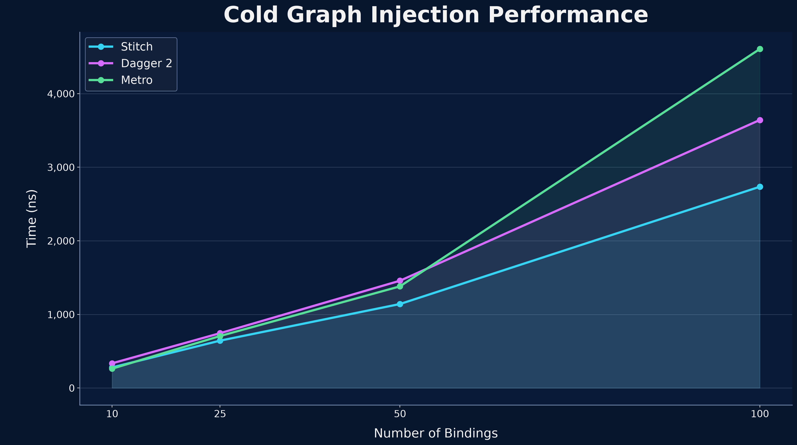
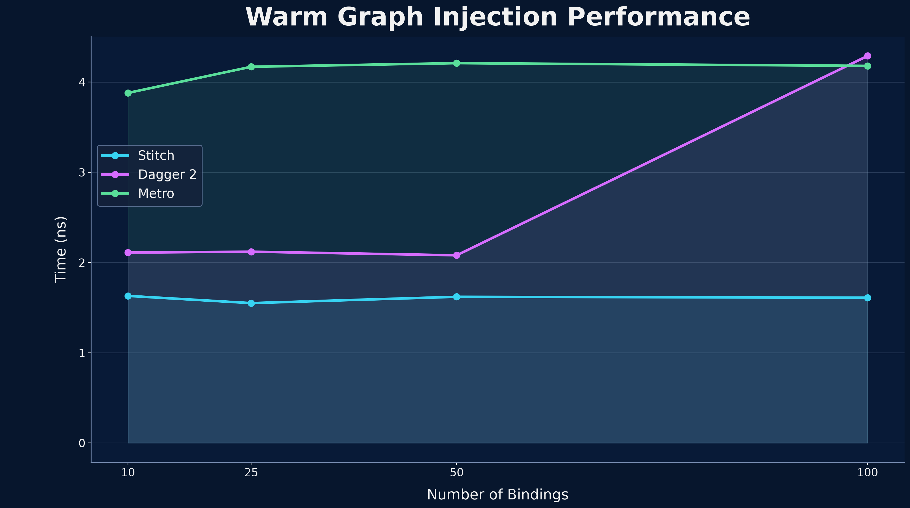
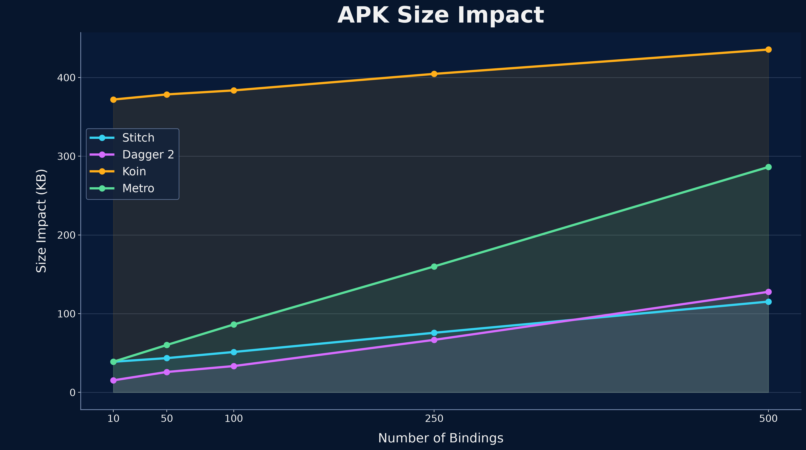
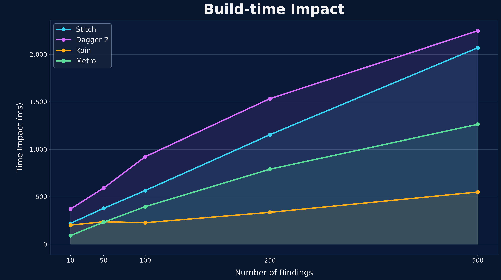

# Stitch

[](https://github.com/harrytmthy/stitch/actions)
[](https://github.com/harrytmthy/stitch/blob/main/LICENSE)
[](https://github.com/harrytmthy/stitch/releases)

A Kotlin Multiplatform dependency injection library with a precompiled path and a runtime
registration path, built to combine Dagger-like performance with Koin-like flexibility.

## Why Stitch?

Today, dependency injection tools often force a tradeoff:

- **Dagger 2** is fast, but has no runtime binding registration and no multiplatform support.
- **Koin** allows runtime registration, but has slower resolutions and higher APK-size impact.
- Using **Dagger 2 + Koin** means carrying two mental models and the combined trade-offs.

Stitch brings both models into one library without the combined trade-offs, while delivering
**~400× faster injection than Koin** and **1.3-2.7× faster injection than Dagger 2** when dependencies are already
initialized.

## At a Glance

| Capability                         |       Stitch        | Dagger 2  |   Koin    |   Metro   |
|------------------------------------|:-------------------:|:---------:|:---------:|:---------:|
| Runtime binding registration       |          ✅          |     ❌     |     ✅     |     ❌     |
| Parent-child scope dependencies    |          ✅          |     ✅     |     ❌     |     ✅     |
| Kotlin Multiplatform support       |          ✅          |     ❌     |     ✅     |     ✅     |
| Amount of rituals (boilerplate)    |      ✅ Lowest       | ❌ Highest |   ✅ Low   |   ✅ Low   |
| Warm injection performance         |      ✅ Fastest      |  ✅ Fast   | ❌ Slowest |  ✅ Fast   |
| APK size impact on larger graphs   |      ✅ Lowest       |   ✅ Low   | ❌ Highest |  ❌ High   |
| Build-time impact on larger graphs | ✅ Lower than Dagger | ❌ Highest | ✅ Lowest  |   ✅ Low   |

**Notes:**
- "Larger graphs" refers to the 500-binding benchmark.
- See [Performance Benchmarks](#performance-benchmarks) for the measurement details.

## Installation

### Runtime registration path

```kotlin
dependencies {
    implementation("io.github.harrytmthy:stitch:1.1.0-rc01")
}
```

### Precompiled path

```kotlin
dependencies {
    implementation("io.github.harrytmthy:stitch:1.1.0-rc01")
    compileOnly("io.github.harrytmthy:stitch-annotations:1.1.0-rc01")
    ksp("io.github.harrytmthy:stitch-ksp:1.1.0-rc01")
}
```

This path requires [KSP2](https://kotlinlang.org/docs/ksp-quickstart.html) enabled in every module
that uses annotations:

```kotlin
plugins {
    id("com.google.devtools.ksp") version "2.3.12"
}
```

## Basic Usage

### Runtime registration path

Create a scope reference and a module:

```kotlin
// Top-level declaration
val activityScope = scope("activity")

val coreModule = module {
    singleton { LoggerImpl() }.bind<Logger>()
}

val homeModule = module {
    factory { HomeConfig() }
    scoped(activityScope) { HomeViewModel(logger = get(), config = get()) }
}
```

Register the modules:

```kotlin
Stitch.register(coreModule, homeModule)

// Alternatively, in a multi-module environment
coreModule.register() // or Stitch.register(coreModule)
homeModule.register() // or Stitch.register(homeModule)
```

Resolve singleton and factory bindings:

```kotlin
val config: HomeConfig = Stitch.get()

// Lazy initialization
val logger by Stitch.inject<Logger>()
```

Resolve scoped bindings:

```kotlin
val homeActivityScope = activityScope.createScope()
val viewModel: HomeViewModel = homeActivityScope.get()

// Cleanup
homeActivityScope.close()
```

Use `dependsOn()` to establish parent-child dependencies:

```kotlin
// One-time setup
val fragmentScope = scope("fragment").dependsOn(activityScope)

// Use it anywhere
val homeActivityScope = activityScope.createScope()
val homeFragmentScope = homeActivityScope.createChildScope(fragmentScope)
val activityViewModel = homeFragmentScope.get<HomeViewModel>()
```

### Precompiled path

#### One-time setup

Annotate any class in the main module with `@StitchRoot`:

```kotlin
@StitchRoot
class SampleApp : Application()
```

Build, then initialize the generated root graph at your app bootstrap point:

```kotlin
StitchInjector.init(StitchSingletonGraph())
```

For multi-module projects, see the [Multi-Module Setup guide](docs/MULTI_MODULE.md).

#### Scopes

Define custom scopes, where 1 scope = 1 generated graph:

```kotlin
@Scope // Any scope is a child of @Singleton by default
@Retention(AnnotationRetention.BINARY)
annotation class Activity

@Scope
@DependsOn(Activity::class) // Makes @Fragment a child of @Activity
@Retention(AnnotationRetention.BINARY)
annotation class Fragment
```

#### Providing and requesting bindings

To provide a binding, use an `@Inject`-annotated constructor or an `@Provides`-annotated function:

```kotlin
@Activity
class HomeViewModel @Inject constructor(
    private val logger: Logger,
) : ViewModel() { /* ... */ }

// Anywhere, even at top-level
@Singleton
@Provides
@Binds(aliases = [Logger::class]) // Binds LoggerImpl to Logger
fun provideLogger(): LoggerImpl = LoggerImpl()
```

To request the provided binding, use an `@Inject`-annotated field:

```kotlin
class HomeActivity : AppCompatActivity() {
    
    @Inject
    lateinit var viewModel: HomeViewModel
}
```

`HomeViewModel` is provided in `@Activity`, while the parent of `@Activity` is `@Singleton`. So,
to inject it, create the activity graph's injector from its parent:

```kotlin
val activityInjector = StitchInjector.getSingletonGraph()
    .createInjectorForChildScope("activity") // Case-insensitive

// Injects HomeViewModel and other @Inject-annotated fields (if any)
activityInjector.inject(this)
```

To inject fragment-scoped bindings:

```kotlin
// @Fragment depends on @Activity, so use activityInjector to create fragmentInjector
val fragmentInjector = activityInjector.createInjectorForChildScope("fragment")
fragmentInjector.inject(this)
```

To defer resolution, request `Provider<T>` instead of `T`. On JVM and Android, `javax.inject.Provider`
works the same way:

```kotlin
@Activity
class HomeViewModel @Inject constructor(
    private val repository: Provider<HomeRepository>, // Resolved on each get()
) : ViewModel()
```

Unlike Dagger 2, there is no `@Module` or `@Component`. Graphs are generated in the same module as
the `@StitchRoot`-annotated class.

## Performance Benchmarks

Stitch was benchmarked across three dimensions:

### Injection performance

#### Cold injection

Measures the first resolution of a binding backed by an N-deep dependency chain. Stitch is **1.16-1.33× faster than
Dagger 2** and **64-76× faster than Koin** at every size. Metro is slightly faster at 10 bindings, but Stitch overtakes
it from 25.



*Note: Koin is omitted from the chart for readability.*

| Bindings | Stitch          | Dagger 2                        | Koin                            | Metro                           |
|----------|-----------------|---------------------------------|---------------------------------|---------------------------------|
| 10       | **279.79 ns**   | 335.39 ns<br>*(1.20× slower)*   | 17,922.77 ns<br>*(64× slower)*  | 262.25 ns<br>*(0.94× slower)*   |
| 25       | **643.51 ns**   | 744.79 ns<br>*(1.16× slower)*   | 43,218.67 ns<br>*(67× slower)*  | 706.53 ns<br>*(1.10× slower)*   |
| 50       | **1,141.22 ns** | 1,457.90 ns<br>*(1.28× slower)* | 86,800.44 ns<br>*(76× slower)*  | 1,381.31 ns<br>*(1.21× slower)* |
| 100      | **2,734.82 ns** | 3,642.17 ns<br>*(1.33× slower)* | 187,182.74 ns<br>*(68× slower)* | 4,606.65 ns<br>*(1.68× slower)* |

#### Warm injection

Measures injection after the required bindings have been initialized. Stitch is **1.3-2.7× faster than Dagger 2**
and **over 380× faster than Koin** at every size.



*Note: Koin is omitted from the chart for readability.*

| Bindings | Stitch      | Dagger 2                    | Koin                         | Metro                       |
|----------|-------------|-----------------------------|------------------------------|-----------------------------|
| 10       | **1.63 ns** | 2.11 ns<br>*(1.30× slower)* | 624.53 ns<br>*(383× slower)* | 3.88 ns<br>*(2.38× slower)* |
| 25       | **1.55 ns** | 2.12 ns<br>*(1.37× slower)* | 625.91 ns<br>*(404× slower)* | 4.17 ns<br>*(2.69× slower)* |
| 50       | **1.62 ns** | 2.08 ns<br>*(1.28× slower)* | 651.30 ns<br>*(401× slower)* | 4.21 ns<br>*(2.59× slower)* |
| 100      | **1.61 ns** | 4.29 ns<br>*(2.67× slower)* | 659.45 ns<br>*(410× slower)* | 4.18 ns<br>*(2.60× slower)* |

### APK size impact

Stitch stays **4-10× below Koin** across all graph sizes. Dagger 2 has a smaller APK footprint up to 250 bindings,
but Stitch crosses below Dagger by 500.



| Bindings | Stitch        | Dagger 2                      | Koin                        | Metro                         |
|----------|---------------|-------------------------------|-----------------------------|-------------------------------|
| 10       | **+38.9 KB**  | +15.3 KB<br>*(0.39× larger)*  | +372.0 KB<br>*(10× larger)* | +38.9 KB<br>*(1.00× larger)*  |
| 50       | **+43.5 KB**  | +25.9 KB<br>*(0.59× larger)*  | +378.5 KB<br>*(9× larger)*  | +60.2 KB<br>*(1.38× larger)*  |
| 100      | **+51.3 KB**  | +33.4 KB<br>*(0.65× larger)*  | +383.6 KB<br>*(7× larger)*  | +86.2 KB<br>*(1.68× larger)*  |
| 250      | **+75.7 KB**  | +66.7 KB<br>*(0.88× larger)*  | +404.6 KB<br>*(5× larger)*  | +160.0 KB<br>*(2.11× larger)* |
| 500      | **+115.3 KB** | +127.7 KB<br>*(1.11× larger)* | +435.5 KB<br>*(4× larger)*  | +286.3 KB<br>*(2.48× larger)* |

### Build-time impact

Stitch has lower build-time impact than Dagger 2 at every measured graph size. Koin and Metro have lower impact than
Stitch.



| Bindings | Stitch           | Dagger 2                         | Koin                           | Metro                            |
|----------|------------------|----------------------------------|--------------------------------|----------------------------------|
| 10       | **+218.24 ms**   | +369.44 ms<br>*(1.69× larger)*   | +200.04 ms<br>*(0.92× larger)* | +90.69 ms<br>*(0.42× larger)*    |
| 50       | **+377.32 ms**   | +591.72 ms<br>*(1.57× larger)*   | +235.41 ms<br>*(0.62× larger)* | +230.82 ms<br>*(0.61× larger)*   |
| 100      | **+564.80 ms**   | +921.82 ms<br>*(1.63× larger)*   | +225.29 ms<br>*(0.40× larger)* | +394.38 ms<br>*(0.70× larger)*   |
| 250      | **+1,152.27 ms** | +1,532.42 ms<br>*(1.33× larger)* | +334.59 ms<br>*(0.29× larger)* | +789.89 ms<br>*(0.69× larger)*   |
| 500      | **+2,068.91 ms** | +2,247.15 ms<br>*(1.09× larger)* | +549.03 ms<br>*(0.27× larger)* | +1,261.47 ms<br>*(0.61× larger)* |

The raw measurements of each release are in [docs/benchmarks](docs/benchmarks). See the injection benchmark's
[methodology](benchmark/README.md) and [full results](benchmark/RESULTS.md).

## Migrating to Stitch

Looking to move from Dagger 2, Hilt, or Koin? See [MIGRATION.md](docs/MIGRATION.md).

## License

```text
Apache License 2.0
Copyright (c) 2026 Harry Timothy Tumalewa
```
